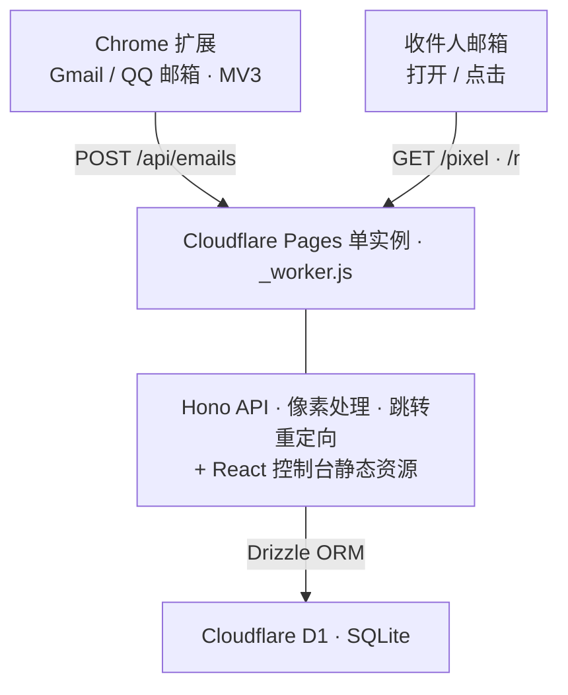
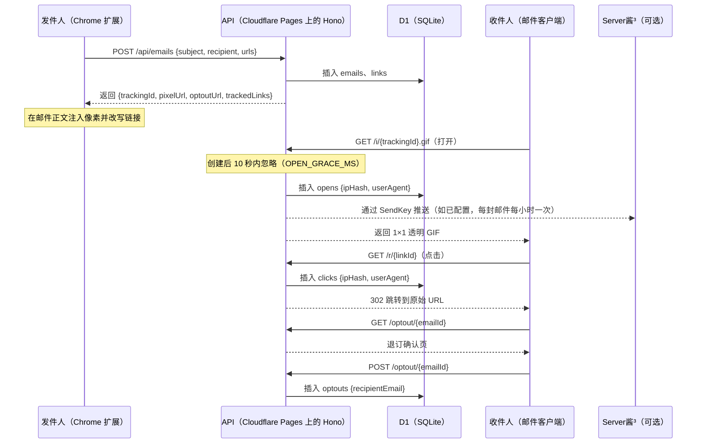

# 📬 pixletter

> **开源邮件追踪工具，每月 $0，托管于 Cloudflare**

Chrome 扩展 + 控制台，用于追踪从 Gmail 和 QQ 邮箱发出的邮件的打开与链接点击。让你的追踪数据掌握在自己手里，同时每月花费 $0。

[](https://github.com/dkamehat/pixletter/actions) []() []() []()

控制台与 API 运行在**同一个 Cloudflare Pages 实例**上（`_worker.js` 高级模式）。`apps/api/` 中的 API 源码在构建时打包进 Pages，不会单独部署 Worker。


---

## 我为什么会做这个项目

作为一名每天处理大量商务沟通的产品经理，我每天要发出几十封邮件——给高管的项目进展、与 74 人团队的协作、与外部伙伴的跟进。我完全不知道是否有人真的读过它们。

我每周要花 **2-3 个小时**打电话、发 Slack 消息，只为了确认对方看到了邮件。现有的方案都不合我意：Mailtrack、MailSuite 每个账号每月收费 $5-10，更糟的是，它们会把你的追踪数据经由自己的服务器转发。对于处理敏感商务沟通和求职邮件的人来说，这从一开始就无法接受。

于是我自己做了一个。技术上的赌注是**全面押注 Cloudflare 免费套餐**——用一个 Pages 实例同时提供控制台和 Hono API（`_worker.js`），用 D1（边缘端 SQLite）做存储。整套技术栈每月 $0，各项配额都有约 1000 倍的余量。我特意选择 **AGPLv3**，既保持代码可自由地自托管，又防止专有 SaaS 直接 fork——这和 Plausible Analytics、Cal.com 的模式一样。

开发过程中最让我意外的是：

- **Gmail 的图片代理**会缓存追踪像素，导致重复打开检测不可靠。这是基于像素的追踪的根本局限，任何工具都无法完全解决。
- **收件人的隐私保护确实有效。** Apple Mail 隐私保护、图片屏蔽、Proton Mail 都能轻松绕过追踪。我把这一点写得很显眼，因为我坚信收件人应该始终保有控制权。
- **伦理章节比 API 写得还久。** 撰写禁止用途条款和 GDPR 合规文档，比实现 12 个 API 接口还难。但这是我最自豪的部分——没有这些，这个工具就是不负责任的。

一个人在一周内做成，兼职 PM 的身份。34 个测试、TypeScript 严格模式、CI 全绿。整个开发过程记录在 ADR 和一篇 [Claude Code 案例研究](docs/CLAUDE-CODE-CASE-STUDY.md)中。

---

## 🏗️ 架构



**整套技术栈都运行在 Cloudflare 上。一个 Pages 实例同时提供 API 和控制台。边缘端的数据库访问让像素响应 P95 < 30ms。**

---

## 📦 功能

### API（基于 Cloudflare Pages 的 Hono）v0.3.0
- `POST /api/emails` — 登记邮件；返回 tracking_id、像素 URL、追踪链接和退订 URL
- `GET /pixel/:id.gif` — 返回 1×1 透明 GIF 并记录打开事件（IP 经过 SHA-256 哈希）
- `GET /r/:id` — 302 跳转到原始 URL 并记录点击事件
- `GET /api/emails` — 列出已发邮件及其打开/点击次数（分页）
- `GET /api/emails/:id` — 邮件详情，含打开时间线和每个链接的点击次数
- `POST /api/emails/:id/optout` — 收件人退订（API）
- `GET/POST /optout/:emailId` — 面向收件人的公开退订页（无需认证）
- `GET /api/account/usage` — 本月发送数量 / 限额
- `DELETE /api/account/data` — GDPR 数据删除
- `GET /api/account/data` — GDPR 数据导出
- `POST /api/auth/*` — Better Auth 认证（托管模式）
- `GET /privacy` — 隐私政策
- `GET /terms` — 服务条款

### Chrome 扩展（Manifest V3）
- 支持 **Gmail** 和 **QQ 邮箱**（`mail.qq.com`）的写信窗口
- 发送按钮旁的追踪开/关切换按钮
- 发送时自动注入追踪像素并改写链接
- 已发送文件夹中的 ✓（未读）/ ✓✓（已读）状态图标
- 设置弹窗（API URL、API Key、Server酱³ SendKey）

> QQ 邮箱说明：它的写信编辑器位于动态生成的 iframe 中，且选择器会随版本变化。扩展会扫描每个 frame 并尝试多个后备选择器；如果 QQ 邮箱界面更新后切换按钮不再出现，针对该服务商的选择器位于 `apps/extension/src/content.js` 的 `PROVIDERS.qqmail` 下。


### 控制台（React + Vite）
- 按时间倒序展示邮件发送历史
- 每封邮件的打开时间线（UserAgent + Gmail 代理识别）
- 汇总的打开率 / 点击率
- 按收件人、主题或标签搜索和筛选

### 多租户认证（第二阶段）
- 集成 Better Auth（邮箱/密码 + Google OAuth）
- Chrome 扩展使用 API Key 认证（SHA-256 哈希存储）
- `HOSTING_MODE` 开关：self（开源自托管）/ hosted（官方托管）
- 每月发送限额（免费版：500 封/月，新账号：100 封/24 小时，可通过 `NEW_USER_EMAIL_LIMIT` 调整）
- 自动封禁（收到 10 次以上退订后暂停账号）
- GDPR 数据删除与导出

### 可观测性与安全
- X-Request-ID / X-Response-Time 响应头
- 速率限制（每个 IP 每分钟 100 次请求）
- 邮件打开时通过 Server酱³ 推送（[sc3.ft07.com](https://sc3.ft07.com)，使用扩展中配置的每个用户自己的 SendKey，每封邮件每小时最多一次；默认忽略创建后 10 秒内的打开，可通过 `OPEN_GRACE_MS` 调整）
- CORS 来源限制（`ALLOWED_ORIGINS` 环境变量）
- Cloudflare Web Analytics / Pages 分析（仓库内无配置——在控制面板中管理）

---

## 💰 零成本基础设施

| 服务 | 免费额度 | 预计用量 | 余量 |
|---|---|---|---|
| Cloudflare Pages（含 `_worker.js` 请求） | 10 万次请求/天 · 无限带宽 · 500 次构建/月 | 100 次请求/天 · 30 次构建/月 | **1000×** |
| Cloudflare D1 | 5GB · 500 万次读取/天 | < 1MB · 100 次读取/天 | **50,000×** |
| GitHub 公开仓库 | 无限 | — | ∞ |

**合计：每月 $0。与 SaaS 竞品相比，三年可节省 $180–$864（[ADR-002](docs/ADR-002-free-tier-operations.md)）**

---

## 🛠️ 技术栈

| 层级 | 技术 |
|---|---|
| Chrome 扩展 | Manifest V3 · Service Worker · Content Script |
| API + 控制台 | Cloudflare Pages（单实例，`_worker.js`）· Hono v4 · React 19 · Vite 6 |
| 数据库 | Cloudflare D1（SQLite）· Drizzle ORM |
| Monorepo | Turborepo · pnpm |
| 认证 | Better Auth（直连 D1） |
| 测试 | Vitest · @cloudflare/vitest-pool-workers（34 个测试） |
| 可观测性 | X-Request-ID · X-Response-Time · Pages 分析 |
| CI/CD | GitHub Actions |
| 许可证 | AGPL-3.0-or-later |

---

## 🚀 部署与配置

### 一键部署（Fork 后部署）

1. Fork 本仓库
2. 添加 GitHub Secrets：`CLOUDFLARE_API_TOKEN`、`CLOUDFLARE_ACCOUNT_ID`（若数据库名不是 `pixletter-db`，再添加 `D1_DATABASE_NAME`）
3. 进入 Actions → “Deploy to Cloudflare” → 运行工作流
4. **一次性操作，在 Cloudflare 控制面板中完成**：绑定 D1（`DB`），设置变量和密钥（见下文）。工作流只部署代码和运行迁移——它故意不触碰绑定、变量和密钥，因此你手动设置的内容在重新部署后会保留。

> **绑定、变量与密钥需要手动配置（只需一次）。** 在 Pages 项目 → Settings → Functions 中，把你的 D1 数据库绑定为 `DB`，添加变量（`HOSTING_MODE`、`ALLOWED_ORIGINS`、`ALLOW_SIGNUP`，以及可选的 `NEW_USER_EMAIL_LIMIT` / `OPEN_GRACE_MS`）和密钥（`BETTER_AUTH_SECRET`、OAuth/Stripe 密钥，以及可选的 `SERVERCHAN_SENDKEY`），并且**生产环境和预览环境都要设置**。完整步骤见 [SELF-HOST-GUIDE.md](docs/SELF-HOST-GUIDE.md)。

### 手动配置

```bash
# 克隆
git clone https://github.com/dkamehat/pixletter.git
cd pixletter
pnpm install

# Cloudflare D1 配置
pnpm wrangler login
pnpm wrangler d1 create pixletter-db
# → 在 apps/api/wrangler.toml 中更新 database_id

# 数据库迁移
pnpm db:generate
pnpm db:migrate:local    # 本地 D1
pnpm db:migrate:remote   # 生产 D1
pnpm db:seed:self        # 初始化 self 租户 + 用户

# 启动开发服务器
pnpm dev                 # Vite 控制台开发服务器
pnpm dev:pages           # 本地 Pages：先构建控制台 + API worker，再运行 wrangler pages dev

# 运行测试
pnpm test
pnpm type-check

# 安装 Chrome 扩展
# 1. 打开 chrome://extensions
# 2. 开启“开发者模式”
# 3. 点击“加载已解压的扩展程序”，选择 apps/extension/
```

详见 [SETUP.md](SETUP.md)。

---

## 📸 截图

### 首页与登录
| 首页 | Google 登录 |
|---------|-------------|
|  |  |

### 新手引导（3 步）
| 1. 生成 API Key | 2. 安装扩展 | 3. 发送测试邮件 |
|---------------------|---------------------|-------------------|
|  |  |  |

### Chrome 扩展
| 扩展弹窗 | Chrome 扩展管理页 |
|----------------|----------------------|
|  |  |

### Gmail 与控制台
| Gmail 写信界面（追踪开启） | 控制台 |
|--------------------------|-----------|
|  |  |

### 隐私控制
| 退订页 | 退订成功 | 已退订 |
|-------------|-----------|-------------------|
|  |  |  |

---

## 📚 文档

| 文档 | 说明 |
|---|---|
| [ADR-001](docs/ADR-001-stack-selection.md) | 技术栈选型 ADR |
| [ADR-002](docs/ADR-002-free-tier-operations.md) | 免费套餐运营 ADR |
| [ADR-003](docs/phase2/ADR-003-multi-tenant-architecture.md) | 多租户架构 |
| [ADR-004](docs/phase2/ADR-004-oss-licensing-and-hosting-model.md) | 采用 AGPLv3 的理由 |
| [CHECKLIST.md](CHECKLIST.md) | 第一天执行清单 |
| [API-REFERENCE.md](docs/API-REFERENCE.md) | API 参考 |
| [GOOGLE-OAUTH-SETUP.md](docs/GOOGLE-OAUTH-SETUP.md) | Google OAuth 配置指南 |
| [SELF-HOST-GUIDE.md](docs/SELF-HOST-GUIDE.md) | 自托管指南 |
| [MANUAL-DEPLOY.md](docs/MANUAL-DEPLOY.md) | 手动构建与部署（Release 产物 / 手动上传 JS / 手动初始化数据库与变量） |
| [CLAUDE-CODE-CASE-STUDY.md](docs/CLAUDE-CODE-CASE-STUDY.md) | Claude Code 案例研究 |

---

## ⚠️ 合规使用与法律须知

邮件追踪在法律和伦理上都是敏感行为。本工具仅设计用于正当场景。

### 允许的使用场景
- 追踪**你自己**发出的邮件的打开/点击情况（例如判断跟进时机）
- 收件人已**明确选择接收**的营销邮件
- 事先已告知会进行追踪的内部团队沟通

### 禁止的用途

**以下用途违反本软件的设计初衷：**

- **亲密伴侣监控**——通过追踪邮件监视伴侣行为（可能成为家庭暴力/虐待的攻击途径）
- **未经同意的员工监控**——在未获得知情书面同意的情况下追踪员工邮件
- **跟踪记者/活动人士/消息源**——任何可能损害新闻自由或危及他人安全的用途
- **跟踪骚扰**——利用追踪数据恐吓、威胁或骚扰收件人
- **大规模未经请求的邮件追踪**——在垃圾邮件或批量未经请求的邮件中附加追踪像素

如果你发现此类滥用行为，请通过 GitHub Issues 举报。

> **注意：** 尽管本软件采用 AGPLv3 许可证，作者仍强烈要求用户遵守上述禁止用途，这是伦理层面的要求。对已证实的滥用举报，作者将公开声明与该部署划清界限并停止支持。

### 隐私与合规

- **GDPR（欧盟）**：发件人必须告知收件人正在使用追踪。IP 地址通过 SHA-256 哈希进行假名化处理（并非完全匿名；这样既能去重，又能减少直接暴露个人身份信息）。可通过 [`DELETE /api/account/data`](apps/api/src/routes/gdpr.ts) 完整删除数据（GDPR 第 17 条）。
- **APPI（日本）**：从不存储原始 IP 地址——只存储 SHA-256 [假名化哈希](apps/api/src/lib/hash.ts)。从不存储邮件正文内容。
- **CAN-SPAM（美国）**：商业邮件必须提供退订机制。本工具在 `/optout/:emailId` 提供了[一键退订页](apps/api/src/routes/optout.ts)。

### 收件人可以阻止追踪

基于像素的邮件追踪**很容易被收件人绕过**。这是有意设计的——收件人始终保有控制权：

- 在邮件客户端中关闭“加载远程图片”
- 使用 Apple Mail 隐私保护（通过代理预取所有图片）
- 使用 VPN 或 Tor
- 使用会剥离追踪像素的邮件客户端（如 Hey、Proton Mail）

**Gmail 图片代理**：Google 会缓存图片，这可能导致无论实际打开几次都只记录一次打开。这是所有基于像素的追踪系统的已知局限。

这些都不是缺陷——它们是保护收件人自主权的功能。


### 内置保护措施

这些不只是条款——它们**在代码中被强制执行**：

- **每封邮件都带退订链接**：API 响应始终包含 `optoutUrl` 和 `optoutHtml` 页脚。在托管模式下，无论用户设置如何都会[强制注入](apps/api/src/routes/emails.ts#L176)。收件人一键即可停止追踪。
- **推送频率限制**：Server酱³ 打开推送对每封邮件在 1 小时窗口内抑制重复推送，并忽略邮件创建后 10 秒内的打开（可通过 `OPEN_GRACE_MS` 调整），以避免邮件客户端造成的双重“已读”事件。
- **新账号限额**：注册后的前 24 小时默认最多发送 100 封（`NEW_USER_EMAIL_LIMIT`），以遏制滥用。
- **滥用自动封禁**：收到[超过 10 次退订的账号会自动暂停](apps/api/src/lib/abuse.ts#L6)，无需人工干预。

### 数据存储

- 所有数据存储于你部署所在区域的 **Cloudflare D1**（SQLite）
- IP 地址经过**假名化**（SHA-256 哈希）——从不存储原始值
- 从不存储邮件正文内容——只存储元数据（主题、收件人、时间戳）
- 收件人可随时通过 `/optout/:emailId` 退订
- 可通过 [`/api/account/data`](apps/api/src/routes/gdpr.ts) 完整导出和删除数据

### 安全

已知的开发依赖漏洞（wrangler、undici、esbuild）不会影响生产运行环境（Cloudflare Pages）。详细分析见 [SECURITY.md](SECURITY.md)。

### 免责声明与你的责任

本软件按“现状”提供，不作任何明示或暗示的保证。作者不对因使用本软件而产生的任何索赔、损害或其他责任负责。

部署或使用 pixletter，即表示你确认：

1. **你独自负责**遵守收件人所在所有司法管辖区的全部适用法规（GDPR、CAN-SPAM、APPI 等）。
2. **在法律要求的地方，你必须告知收件人**。本工具提供了退订机制，但告知追踪的法律义务在于你，而非软件作者。
3. **作者不提供法律意见。** 针对你的具体用例和所在司法管辖区，请咨询合格的律师。
4. **滥用举报可能导致公开披露。** 如果上述禁止用途被举报并核实，作者保留公开声明与该部署划清界限的权利。

本免责声明是对 [AGPLv3 许可证条款](LICENSE)的补充，而非替代。

---

## 🔄 数据流与留存

### 数据流



### 数据留存

| 数据 | 留存期 | 删除触发条件 |
|------|-----------|------------------|
| 邮件元数据（主题、收件人、时间戳） | 直到账号删除 | `DELETE /api/account/data` |
| 打开事件（ipHash、userAgent、时间戳） | 直到账号删除 | `DELETE /api/account/data` |
| 点击事件（ipHash、userAgent、时间戳） | 直到账号删除 | `DELETE /api/account/data` |
| 链接映射（originalUrl、trackingId） | 直到账号删除 | `DELETE /api/account/data` |
| 退订记录（recipientEmail） | 永久 | 从不删除（保护收件人） |
| 认证会话 | 闲置后过期 | Better Auth 会话过期 |
| 每月发送计数器 | 每 30 天重置 | 在 reset_at 自动重置 |
| 租户记录（删除时） | 软删除 | isSuspended=true，name 设为 [deleted] |

### 不会存储的内容

- ❌ 邮件正文内容（只存主题行）
- ❌ 原始 IP 地址（只存 SHA-256 假名化哈希）
- ❌ 附件数据
- ❌ 收件人的邮件内容或收件箱数据

### 级联删除

`DELETE /api/account/data` 按外键顺序执行级联删除：

`clicks → opens → links → emails → optouts → apiKeys → users → tenant（软删除）`

所有追踪数据都会被永久移除。租户记录仅出于审计目的以暂停状态保留。

### GDPR 数据导出 — 响应示例

```json
{
  "exportedAt": "2026-01-15T10:30:00.000Z",
  "tenant": {
    "id": "txxxxxxxxxxxxxxxxxxx",
    "name": "Alice Example",
    "plan": "free",
    "monthlyEmailLimit": 500,
    "monthlyEmailCount": 12,
    "resetAt": "2026-02-15T10:30:00.000Z",
    "isSuspended": false,
    "createdAt": "2025-12-15T10:30:00.000Z"
  },
  "emails": [
    {
      "id": "emxxxxxxxxxxxxxxxxxx",
      "trackingId": "trxxxxxxxxxxxxxxxxxx",
      "subject": "Project status update",
      "recipient": "bob@example.com",
      "recipientName": "Bob",
      "sentAt": "2026-01-15T09:00:00.000Z"
    }
  ],
  "opens": [
    {
      "id": "opxxxxxxxxxxxxxxxxxx",
      "emailId": "emxxxxxxxxxxxxxxxxxx",
      "userAgent": "Mozilla/5.0 ...",
      "ipHash": "a1b2c3d4...(SHA-256)",
      "isGmailProxy": false,
      "openedAt": "2026-01-15T09:05:00.000Z"
    }
  ],
  "clicks": [],
  "links": [],
  "optouts": []
}
```

---

## 📅 路线图

- [x] **第 1 天**：PRD、ADR、数据库 schema、monorepo 初始化、D1 配置
- [x] **第 2 天**：API 实现（6 个接口）+ Vitest
- [x] **第 3 天**：Chrome 扩展 MV3（追踪开关、像素注入、链接改写）
- [x] **第 4 天**：已发送文件夹 ✓✓ 图标 + React 控制台
- [x] **第 5 天**：Slack 通知 + 速率限制（后改为 Server酱³）
- [x] **第 6 天**：可观测性（Request-ID、Response-Time）+ 测试扩充（5→18）
- [x] **第 7 天**：README 完善 + 公开发布

### 第二阶段：开源发布与官方托管
- [x] Better Auth 多租户认证（ba_user/session/account/verification）
- [x] 注册 → 自动创建租户（databaseHooks）
- [x] tracking.ts 中动态 tenant_id
- [x] 每月发送限额 + 新账号 24 小时限制
- [x] 强制注入退订 URL + 公开退订页
- [x] 自动封禁（超过 10 次退订后暂停）
- [x] GDPR 数据删除 / 导出 API
- [x] 隐私政策 + 服务条款
- [x] 首页 + 注册 / 登录界面
- [x] 用量控制台（UsageBanner）
- [x] 部署到 Cloudflare（控制台 + API 共用单个 Pages 实例）
- [x] 新手引导流程
- [ ] `npx create-pixletter@latest` 配置向导
- [ ] 文档站点

---

## 📄 许可证

AGPL-3.0-or-later.

选择 AGPLv3 是为了确保即便被当作托管服务部署，改进也能保持开源。专有 SaaS 的 fork 必须公开其修改。这既保护了开源生态，又保持了代码可自由地自托管。完整理由见 [ADR-004](docs/phase2/ADR-004-oss-licensing-and-hosting-model.md)。

---

## 🙋 作者

由 [@kame__lift](https://x.com/kame__lift) 开发
